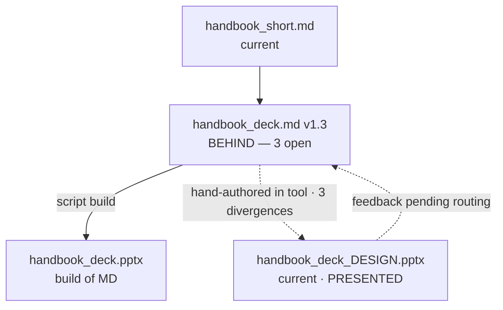

# The Product Ledger

A **product** is one thing said several ways: an outline, a markdown draft, a Word file, a LaTeX paper, a slide deck, a translation. Git records every change made to those files *inside* the repo. It cannot see three things: a representation that was created or edited **outside** the repo; a representation that was **sent or presented** to someone, together with the **feedback** that comes back; and a **decision about the product** that lives only in a conversation. Those events are what put a product's representations out of step with each other — or record why they are allowed to differ — and they are the ledger's entire intake.

The ledger file — `<stem>_LEDGER.md`, living with the product — answers four questions a future session cannot otherwise answer: which representation is current, where the others diverge from it, what has already been asserted to an audience, and what has been decided about the product along the way.

## When to use this skill

Read this skill when:

- The user says a representation was made or changed outside the repo — a deck built in a design tool, a draft edited in Overleaf, a document returned by a co-author, a translation reviewed by someone else.
- The user says a representation was sent or presented — to a manager, a co-author, a client, a meeting.
- Feedback on a sent or presented representation comes back — written comments, or the user relaying them from a meeting or an email.
- The user makes a decision about the product's content or one of its representations that no file records — "this deck has no speaker notes, by choice," "the report covers all sites together, not one by one."
- The user asks which version is current, or what differs between two representations of the same product.
- The user says "make a ledger for this," or a skill that consumes this convention routes here.

Do not use this skill for:

- **How the work is sequenced.** That is `workstream_plan_skill.md`. See *Relationship to the plan file* below — they are orthogonal, and conflating them is the main failure mode.
- **The Protocol 2 divergence table.** `writing_drafting_skill.md` step 8 compares a post-hoc outline to the plan *inside one document*, and closes at merge. This is a sibling, not a parent: different scope (inter-representation, not intra-document) and opposite lifecycle (entries stay open on purpose).
- **A product with one representation, never edited outside the repo and never sent.** Git already tells the whole story. No ledger.
- **Ordinary in-repo revision.** A markdown draft revised over ten commits needs no ledger. The commits are the record.

---

## Where the file lives, and what it is called

`<stem>_LEDGER.md`, in the product's own folder, using the product's stem — the same stem the plan file uses if one exists. `handbook_PLAN.md` and `handbook_LEDGER.md` are siblings on one stem: the plan tracks the work, the ledger tracks the artifacts.

The stem names the *product*, not a representation. A ledger is never named after the deck or after the markdown; both are entries inside it.

---

## Relationship to the plan file

**Plan and ledger are orthogonal, not layered.** A product can have either, both, or neither:

| | Has a plan | No plan |
|---|---|---|
| **Has a ledger** | A deliverable built through a planned workstream that also gets edited outside the repo | A deck someone hands over and keeps revising in a tool, with no workstream behind it |
| **No ledger** | A workstream ending in a decision, a dataset, or a repo restructure | Ordinary in-repo work |

**Neither reads the other for current state.** This is the rule that keeps the pair from rotting:

- The plan **may** point at the ledger as an artifact it produced. It must not restate the ledger's divergences or currency marks.
- The ledger **may** note which plan step produced a representation, as provenance. It must not restate the plan's step state.

If both files carry the same fact, one will fall behind and there is no rule for which wins. This is the non-duplication rule the plan file already applies to `STATUS.md`, applied sideways.

**The trigger differs, which is why the independence matters.** A plan is born when work needs sequencing. A ledger is born on the first outside-edit, first send, or first product-level decision worth recording, whether or not any plan exists. If the ledger were a section of the plan, the case it exists for — an outside edit with no workstream running — would fall through.

---

## What the file contains

Four sections, in this order.

### 1. The sketch — the representation tree

Every ledger carries a sketch: the product's representations and how they derive from each other, with current state at a glance. Mermaid when the structure earns it (a representation with two or more children always earns it); a numbered list is the minimum form.

**The nodes are artifacts, not events.** This is the difference from the plan's sketch, and it changes the vocabulary. In a plan, nodes are steps, arrows are time, and state is `done / in flight / not started`. In a ledger, nodes are files that persist, arrows are **derived-from**, and nothing is ever "done." State marks describe **currency**:

- `current` — nothing above it has moved since it was made
- `behind` — its parent or a sibling has content it lacks
- `ahead` — it carries content not yet reflected in its parent (the normal state of a representation edited outside the repo)
- `unknown` — not checked since the last change

**Edges carry state too.** A derived-from edge records how the child was made and what stands between them:

- **solid** — a reproducible build (a script, a preamble, a compile). No divergence is possible by construction; if the parent changes, rebuild.
- **dotted** — hand-authored, or authored outside the repo. Divergence is possible and the edge carries the open count.

The sketch's job is *which representations are behind, at a glance*. It is re-rendered whenever an event is logged.

**The derivation chain — parts → short → deck.** A written product that exists at several lengths is one chain, not several products: the **parts** (the long sections, each its own file) are the source; the assembled long document, the short document, and the deck are **derivatives**, each derived from the one above it. Feedback propagates to the source first: whichever representation the comments arrived on, the `feedback` entry routes them to the parts, and the `dispositioned` entry naming the absorbing revision is the event that sets every derivative below it to `behind`. A derivative is then **rebuilt from its source**, never patched in place with the feedback — a patch would put it `ahead` of a source that never absorbed the change. Until the rebuild, the sketch shows the derivatives behind with that entry as the reason. The parts are never retired when the long document is assembled from them: they stay the live source, and the assembly is a representation (archive is for retired narratives, per `structure_conventions.md`, "Versions vs. archive").

**Sketch before ledger.** The proposed tree is presented for the user's reaction *before* the file is written. A wrong parent is cheapest to catch on the sketch. This is an enumeration point: present the sketch and stop.

Example:

### 2. The representations table

One row per representation. Columns:

| Column | Content |
|---|---|
| Representation | Path, relative to the ledger |
| Derived from | The **named parent** it was made from, with the parent's version or commit at the time. Never "the previous one" — see *Representations are a tree, not a chain* below |
| How | `build` (named script or preamble) or `hand` (named tool or person) |
| Currency | `current` / `behind` / `ahead` / `unknown` |
| Last event | Date and one-word event type |

### 3. The event log

Dated, most recent first. **Only events git cannot see are logged**, plus the rulings that resolve them:

| Event | Meaning |
|---|---|
| `created-outside` | A representation was made outside the repo |
| `changed-outside` | An existing representation came back changed |
| `sent` | Sent to a named person or group; for a package, written on the user's word at the send or at the next session start's package confirmation (`project_tracker_skill.md`, step 0), the same date going to the packages catalog row |
| `presented` | Presented to a named audience |
| `feedback` | Feedback received: a **pointer to where the comments live** (the repo's `feedback/` folder — never a copy), plus the routing decision (which representation absorbs it). Stays **open** until closed by a `dispositioned` entry |
| `versioned` | The first feedback on the representation arrived and a byte-exact copy of the representation as sent was cut into `versions/` beside it: the copy's path and the `feedback` entry it serves (`structure_conventions.md`, "Versions vs. archive") |
| `decided` | A product-level decision with no divergence attached, recorded with the reasoning and, where it applies, the reopening condition |
| `ruled` | A divergence was adjudicated |
| `dispositioned` | A ruling or a feedback routing was carried out |

Ordinary in-repo commits are **not** logged. Git has them, and a ledger that logs everything becomes a changelog nobody maintains.

**The feedback loop.** When a representation is presented or sent, the comments that come back land in the repo's `feedback/` folder (by person, then date) and the `feedback` entry points there. The revision that answers them is an ordinary in-repo commit — git sees it; what git cannot see is that it *responds to that feedback*, and that link is the ledger's job. The entry stays open until a `dispositioned` entry closes it, naming one of two outcomes: the **absorbing revision** (representation plus version or commit), or — when the response reshapes the product into something of a different shape — the **successor**, per the *product that splits* edge case. An open `feedback` entry shows on the sketch like an open divergence: unabsorbed comments stay visible instead of living only in the feedback file. At the first feedback on a document, a `versioned` entry records the copy cut of what was sent, so the comments stay readable against the exact text.

**What `decided` does and does not catch.** It exists for the decision that would otherwise survive only in a conversation — the kind that gets re-litigated by the next session because nobody wrote down the reasoning. Three routings keep it from becoming a sponge: a ruling on a divergence is `ruled`, not `decided`; a decision about how the work is sequenced belongs to the plan file; and a decision of project scope — priorities, what gets built at all — belongs in `STATUS.md` per `project_tracker_skill.md`. `decided` covers decisions about this product's content or its representations, nothing wider.

### 4. The divergence table

| Column | Content |
|---|---|
| ID | Stable identifier, referenced from the log and from any consumer's map file |
| Between | The two representations, **each with the version or commit it was measured against** |
| What differs | One or two sentences. Both sides stated, neither editorialized |
| Status | `open` / `intentional` / `drift` / `unclear` / `closed` |
| Ruling | The user's decision and the reasoning, dated. Empty while open |
| Disposition | What was done about it, dated. Empty until carried out |

**The status vocabulary is deliberately the same** as `writing_drafting_skill.md`'s divergence table — `intentional` / `drift` / `unclear`, plus a note for the user's future self. Two vocabularies for two kinds of divergence in one repo is how both get misread. What this table adds is what that one does not need: the measured-against versions, an explicit `open` state, and the disposition column.

---

## Workflow

1. **Recognize the intake event.** An outside edit, a send or presentation, feedback arriving, or a product-level decision. If none happened, there is nothing to log.

2. **Identify the product and its stem.** Ask if it is not obvious — the ledger belongs to the product, not to the representation that triggered it. If a plan file exists for the same product, use its stem.

3. **If no ledger exists, render the sketch and stop.** The user reacts to the tree before the file is written. Get the parents right: they are what every divergence is measured against.

4. **Write or update the file.** Sketch, representations table, event log, divergence table.

5. **Establish the divergences.** For an outside-edited representation, compare it against its **named parent** — not against a sibling. A consumer skill may own the comparison method for a format (see *Consumers* below); absent one, compare content section by section and record what differs.

6. **Sort the findings into two bins before asking anything.** A divergence *from the parent* is a question for the user. A defect *internal to the incoming representation* — a slide contradicting its own speaker notes, a table whose total does not match its rows — is not a divergence at all, has no counterpart in the parent, and asking "which is authoritative" about it is a category error. Report it separately as a defect.

7. **Default to deferring the rulings.** Rulings are not forced at intake. Log the divergences as `open` and leave them for the user's next pass on the product. They may rule immediately; they are not asked to.

8. **When a ruling is made, record the reasoning and the reopening condition.** A ruling without its reasoning gets re-litigated by the next session. A ruling closed *no-change* especially needs the reasoning plus an explicit instruction not to "fix" it later on the assumption it was an oversight, and the condition under which it reopens.

9. **Disposition — the step that closes the loop.** Every ruling that goes against a representation leaves that representation wrong. If it is live input to a build, saying so is not enough. Each ruling gets one of:
   - **update** the losing representation to match, or
   - **retire** it formally, or
   - **accept** the divergence knowingly, recorded as accepted.

   When the absorbing representation is the source of a derivation chain, the same entry sets its derivatives to `behind`; they are rebuilt from it, not patched (the chain rule, section 1).

10. **Guard any stale build input.** If a representation ruled behind is the input to a build script, put a visible warning at the head of that file naming the open items and stating that the builder will reissue superseded content. The ledger records the divergence; the warning is what a rebuilding session actually trips over.

11. **Update the lookup surfaces.** `STATUS.md`, any folder map, and the line map's current-shape paragraph all carry a **pointer plus a one-line position** — `4 representations, 3 divergences open, 1 presented` — never a copy of the tables. On any disagreement the ledger wins; the surface line is a cache. The product's row in the repo's typed index (the outputs index) carries `ledger` in its `Where` cell from the moment the ledger is born, and a send or present event sets its `Stage` to `published` (`writing_drafting_skill.md`'s stage words); the row never restates a representation's state or what was sent.

---

## Key rules

- **Only what git cannot see.** Outside edits, sends and their feedback, and decisions that live nowhere else. Everything else is already in the history.
- **Feedback stays open until absorbed.** An open `feedback` entry is visible on the sketch like an open divergence, and it closes only when a `dispositioned` entry names the absorbing revision or the successor product. The comments themselves live in the repo's `feedback/` folder; the ledger points, never copies.
- **Representations are a tree, not a chain.** Every entry names the parent it was derived from. "Different from the previous" is ambiguous the moment a representation has a sibling, and whoever fills it in will pick a neighbor arbitrarily.
- **Every divergence is stamped on both sides.** A divergence is a claim about two specific versions. Unstamped, it reads as current when it is a snapshot — and after either side is revised it may describe a conflict that no longer exists, or miss a new one.
- **Presented is a state, not a note.** Once content has been shown to an audience it has been asserted, whatever the repo says. A divergence in a presented representation means the repo is behind something already said out loud — a different obligation from "not yet decided," and it should be uncomfortable to look at.
- **Plan and ledger never read each other for state.**
- **The ledger owns product facts; structure owns existence.** The ledger owns facts about one product: currency, divergences, audience, decisions. Folder maps and archives own what files exist, where they live, and what is retired. Any surface that aggregates across products — the line map's current-shape paragraph, `STATUS.md` — carries pointers and one-line positions only, never facts of its own. There is no folder-level or line-level ledger: one ledger per product, caches above it.
- **Derivation claims live only in the ledger.** The representations table is the both-sides record: a representation's row names its parent, and its children are the rows naming it — two directions of the same rows, which cannot disagree. Folder maps and the representations themselves never carry their own "based on" / "base of" claims; they carry at most a pointer to the ledger. Distributed derivation notes decay in a known way: sessions write where they are working, so the parent's side never gets written, and notes that do get written outlive the files they point at.
- **Deferring a ruling is normal; losing it is not.** Deferral is the default. Silence is not: an open divergence stays visible on the sketch and in the lookup line until it is ruled and dispositioned.
- **Sketch before ledger**, as an enumeration point.

---

## Edge cases

**A build output that diverges.** It cannot, by construction — that is what makes the edge solid. If a `.pptx` generated by a script differs from what the script produces today, either the script changed or the output was hand-edited after the build. The second is an outside edit and converts the edge to dotted; say which happened rather than logging a divergence against a build.

**Feedback that arrives on the wrong representation.** Common, and the reason `feedback` carries a routing decision. Comments land on whatever artifact the audience was holding — often the one with no builder. The log entry must say which representation absorbs the change, or the comments live wherever they happened to arrive.

**A representation with no parent in the repo.** Something drafted entirely outside and brought in. Its `derived from` is `none — external origin`, and it has no divergences until a sibling exists. This is legitimate; do not invent a parent to fill the column.

**Translations.** A translation's parent is the source-language representation at a named version. When the source is revised, the translation goes `behind` automatically — which is the ledger earning its keep, since a stale translation is otherwise invisible.

**A product that splits.** If a representation stops being a representation of the product and becomes its own product, close its row with a pointer to the new stem rather than deleting it. The history of the split is worth more than a tidy table.

**A product that changes name or genre.** Products mutate identity across review rounds — an outline becomes a study design, a deck becomes a design deck — and the stems on disk diverge accordingly. The ledger **follows the product, not the filename**: rename the ledger file to the product's current stem and log the identity change as an event, because git sees a file rename but cannot see "this is the same product re-understood." The old stems stay in the log, not frozen into the filename. Distinct from a split: a rename is one product continuing under a new identity (one ledger, renamed); a split is two products where there was one (a closed row pointing at a new stem).

---

## Consumers

This skill owns the file convention. A consumer skill owns how a *particular format* is compared and placed, and routes here for the ledger itself. The consumer never re-implements the ledger's structure.

Current consumers in this repo: `design_deck_reconciliation_skill.md`, for decks authored in a design tool outside the repo; `latex_round_trip_skill.md`, for a paper whose LaTeX source is edited in an external editor by co-authors (its refresh is the `changed-outside` event).

---

## Setting up for a new project

Nothing to configure. The ledger is born on first need, takes the product's stem, and lives with the product. If the repo has a `STATUS.md`, its entries carry pointer-plus-position per `project_tracker_skill.md` mechanics.

---

*Last updated: October 10, 2026 — starter-package edition, mirrored from kit v6.11. The version history that preceded this line recorded maintenance internal to the canonical kit and has been dropped. From here on, record your own changes to this file in this marker, newest first, one clause per change, so a later session can see what moved and why.*
